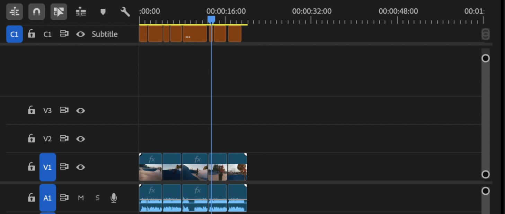
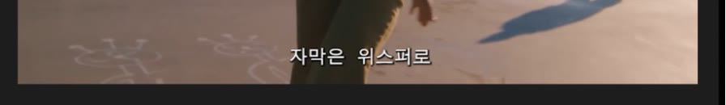

# 실제 영상 검증 (macOS, 2026-11-22)

`skill/mac`의 흐름을 실제 Premiere에서 돌려 본 기록과, 같은 검증을 다시 할 때 쓰는 스크립트다.

- 환경: macOS, Adobe Premiere Pro 2027(27.0.0, 영어 UI), premiere-pro-mcp 1.31.0(CEP 브리지), ffmpeg 9.0.2, faster-whisper 1.2.1(PyAV 15.1, small 모델)
- 테스트 프로젝트는 영문 경로에 새로 만들었고, 모든 Premiere 호출에 `expected_project_path` 가드를 넣었다.

## 스크립트

| 파일 | 하는 일 |
|---|---|
| `make_test_media.sh <출력폴더> [샘플영상폴더]` | macOS `say`(Yuna 음성)로 말 5덩어리를 만들고 사이에 2.0/3.0/2.5/2.2초 무음, 3번째 덩어리 안에 1.0초 짧은 쉼을 넣는다. Premiere 샘플 영상과 합쳐 29.97·23.976·30fps mp4를 만든다(샘플 클립 오디오는 무음이라 버린다). |
| `verify_cuts.py <cuts.json> <readback.json> <fps분자> <fps분모> [--source-frames N]` | 컷 뒤 `get_active_sequence` 결과를 받아, 각 클립의 원본 in/out과 타임라인 위치가 "경계를 가장 가까운 프레임으로 반올림해 빈틈없이 붙인" 기대값과 몇 프레임 차이 나는지 계산한다. |

## 결과 요약

테스트 영상: 30.4초, 긴 무음 4개 + 남겨야 하는 1.0초 쉼 1개. 무음 기준 -30dB, 2.0초, 여유 0.08초.

| 시퀀스 | 컷 방식 | 감지 | 잘림 | 길이 (전 → 후) | 프레임 경계 |
|---|---|---:|---:|---|---|
| 29.97fps (30000/1001) | `ripple_remove_timeline_ranges` dry run → 적용 | 4 | 4 | 30.397초(911프레임) → 20.287초(608프레임) | V1·A1 모든 경계가 기대값과 0프레임 차이 |
| 23.976fps (24000/1001) | `ripple_remove_timeline_ranges` dry run → 적용 | 4 | 4 | 30.405초(729프레임) → 20.354초(488프레임) | 0프레임 차이 |
| 30fps | `razor_all_tracks` 8번 + `ripple_delete` 4번 (대체 경로) | 4 | 4 | 30.400초(912프레임) → 20.333초(610프레임) | 0프레임 차이 |

- 세 경우 모두 V1·A1이 각각 5조각으로 남았고, 1.0초 쉼은 잘리지 않았다.
- `ripple_remove_timeline_ranges` 설명에는 "Integer frame rates only"라고 적혀 있지만 29.97·23.976 시퀀스에서도 거부 없이 동작했다. 도구가 맞춘 경계(`adjustments`)는 `skill/*/scripts/plan_cut_ranges.py`가 계산한 값과 같았다.
- MCP `detect_silence` 도구의 무음 구간은 `detect_silence.sh`(ffmpeg `silencedetect`)와 소수점까지 같았다.

29.97fps 검증 출력:

```text
fps=29.97003, 원본 911프레임, 컷 4개 → 유지 구간 5개
  컷 요청 4.501–6.594초 → 프레임 135–198 (4.5045–6.6066초, 반올림 오차 ≤ 0.38프레임)
  컷 요청 10.198–13.309초 → 프레임 306–399 (10.2102–13.3133초, 반올림 오차 ≤ 0.37프레임)
  컷 요청 18.166–20.766초 → 프레임 544–622 (18.1515–20.7541초, 반올림 오차 ≤ 0.44프레임)
  컷 요청 24.391–26.683초 → 프레임 731–800 (24.3910–26.6933초, 반올림 오차 ≤ 0.31프레임)
[V1] 클립 5개, 기대값과 최대 차이 0.0000프레임, 프레임 경계 이탈 최대 0.0000프레임
[A1] 클립 5개, 기대값과 최대 차이 0.0000프레임, 프레임 경계 이탈 최대 0.0000프레임
시퀀스 길이: 실제 20.2869초 (608.000프레임) / 기대 20.2869초 (608프레임)
판정: 프레임 단위 일치
```

### 오디오 export

`export_sequence` + Premiere 설치본의 `WAV_Mono_16bit_16kHz.epr`, `audio_check: expect_signal`

| 시퀀스 | 도구 결과 | ffprobe |
|---|---|---|
| 29.97 | `durationVerified: true`, 20.287초, peak -4.26 dBFS | `pcm_s16le`, 16000Hz, 1채널, 20.287초, 비디오 스트림 없음 |
| 23.976 | `durationVerified: true`, 20.354초 | `pcm_s16le`, 16000Hz, 1채널, 20.354초 |

컷 뒤 WAV에서 1초 이상 무음은 일부러 남긴 쉼(1.23초) 하나뿐이었다.

### 자막

- faster-whisper small(ko): 어절 34개 → `segment_subtitles.py`(soft 16, gap 0.4) → 자막 8개
  - small 모델이라 합성 음성의 일부 단어를 잘못 들었다(예: "무음" → "모음"). 실제 작업에는 medium 이상을 권한다.
- `import_media`(SRT) → `create_caption_track`(action `import`, subtitle): 도구 결과는 `committed_unverified`(CEP에 자막 읽기 API 없음)
- computer use 스크린샷으로 확인: 타임라인 위쪽에 `C1 Subtitle` 트랙이 생기고 자막 블록 8개가 V1·A1 위에 놓였다. 프로그램 모니터에도 그 시각의 자막이 보였다.





(13.5초: SRT 6번 큐 "자막은 위스퍼로", 13.06–14.02초)

## 검증하지 못한 것

- Windows 스킬(`skill/windows`) 전체
- 한국어 UI에서 이 흐름 전체(도구별로는 1.31.0 전체 테스트의 한국어 UI 1차에서 성공)
- 드롭 프레임 타임코드 시퀀스, 클립이 여러 개인 타임라인, 트랜지션이 있는 타임라인
- faster-whisper medium·large-v3 모델(1GB 넘는 다운로드라 small로만 시험)
